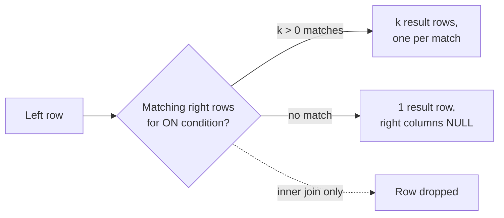
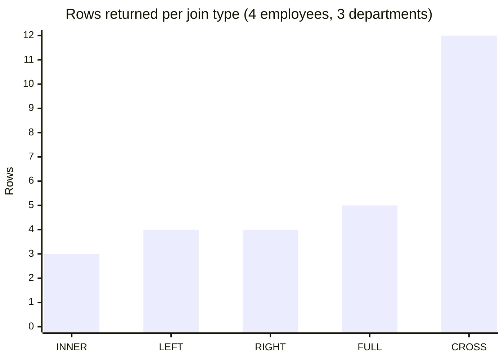

# SQL joins

## Summary

A join combines rows from two tables into result rows, pairing them by a condition, usually that a foreign key equals a primary key. The join type decides what happens to rows that find no partner: an inner join drops them, a left or right outer join keeps the unmatched rows of one side and fills the other side with `NULL`, a full outer join keeps unmatched rows of both sides, and a cross join pairs every row with every row. Joins are how a normalized relational schema is read back together, and the most common sources of wrong results are `NULL` handling and filters placed in the wrong clause.

## Prerequisites

- [Relational model](../../database-design-and-models/relational/relational-model.md) for keys and relationships.
- [SQL language overview](sql-language-overview.md) for where joins sit in a `SELECT`.

## Core concepts

### Definition

A *join* of tables A and B with condition P returns the pairs of rows (a, b) for which P is true, plus, for outer joins, the rows of A or B that have no partner, padded with `NULL` for the missing side. Logically, an inner join is a filtered Cartesian product: `A JOIN B ON P` equals `A CROSS JOIN B WHERE P`. The engine never actually builds the product; it uses a join algorithm (nested loop, hash join or merge join, see [SQL tuning](../../query-processing-and-optimization/sql-tuning.md)).

### Join types

| Join | Rows returned | Venn picture |
| --- | --- | --- |
| `INNER JOIN` | Only pairs that match. | Intersection of left and right. |
| `LEFT [OUTER] JOIN` | All rows of the left table; right side `NULL` where no match. | Whole left circle. |
| `RIGHT [OUTER] JOIN` | All rows of the right table; left side `NULL` where no match. | Whole right circle. |
| `FULL [OUTER] JOIN` | All rows of both tables, matched where possible. | Union of both circles. |
| `CROSS JOIN` | Every combination (Cartesian product), no condition. | Not a Venn diagram. |
| Self join | A table joined with itself under two aliases (employee and manager). | Any of the above. |
| Semi join | Left rows that have at least one match, each once (`EXISTS`, `IN`). | Left part of the intersection. |
| Anti join | Left rows with no match (`NOT EXISTS`). | Left circle minus intersection. |

The Venn picture is a memory aid with a known flaw: it shows sets of rows, but a join produces pairs, so a left row that matches three right rows appears three times. The diagram below shows the decision the engine makes for each left row in a left join.



*Analogy.* An inner join is a dance where only couples who found a partner stay on the floor. A left join lets every person from the left side stay, and those without a partner dance with an empty chair (`NULL`). A cross join makes everyone dance once with everyone. The analogy breaks for one-to-many matches: in SQL one person can dance with several partners at the same time, and each pair is a separate result row.

### ON versus WHERE

For inner joins, a condition in `ON` and the same condition in `WHERE` give the same result. For outer joins they differ:

- a condition in `ON` decides which right rows *match*; unmatched left rows are still kept with `NULL`s,
- a condition in `WHERE` filters the *result* after the join; it removes the `NULL`-padded rows if it tests a right-side column, which silently turns the outer join into an inner join.

### NULL in joins

`NULL` never equals anything, not even `NULL`. A row whose join column is `NULL` therefore never matches in an inner join. The same rule makes `NOT IN` dangerous: if the subquery returns a single `NULL`, `x NOT IN (...)` is `UNKNOWN` for every `x` and the query returns no rows. `NOT EXISTS` does not have this problem.

### Original figure

The SQL learning map in the [SQL language overview](sql-language-overview.md#original-figures) and the relational design infographic in [relational model](../../database-design-and-models/relational/relational-model.md#original-figure) show the same join types as Venn diagrams.

## Worked example

Tested on PostgreSQL 17.11. Four employees, one of them (Linus) without a department, and one department (Legal) without employees.

```sql
CREATE TABLE departments (dept_id int PRIMARY KEY, name text NOT NULL);
CREATE TABLE employees (emp_id int PRIMARY KEY, name text NOT NULL, dept_id int REFERENCES departments);
INSERT INTO departments VALUES (10, 'Engineering'), (20, 'Sales'), (30, 'Legal');
INSERT INTO employees VALUES (1, 'Ada', 10), (2, 'Alan', 10), (3, 'Grace', 20), (4, 'Linus', NULL);

SELECT e.name AS employee, d.name AS department
FROM employees e FULL OUTER JOIN departments d ON d.dept_id = e.dept_id
ORDER BY d.dept_id NULLS LAST, e.emp_id;
```

Output of the full outer join:

```text
 employee | department
----------+-------------
 Ada      | Engineering
 Alan     | Engineering
 Grace    | Sales
          | Legal
 Linus    |
(5 rows)
```

The same tables with the other join types (`ON d.dept_id = e.dept_id` in each case):

| Join | Rows | Result |
| --- | --- | --- |
| `INNER JOIN` | 3 | Ada, Alan, Grace with their departments |
| `LEFT JOIN` (employees left) | 4 | plus Linus with `NULL` department |
| `RIGHT JOIN` | 4 | plus Legal with `NULL` employee |
| `FULL OUTER JOIN` | 5 | both unmatched rows |
| `CROSS JOIN` | 12 | 4 employees times 3 departments |

The row counts per join type, from the outputs above:



Two traps, with real output:

```sql
-- Anti join: departments without employees
SELECT d.name FROM departments d
WHERE NOT EXISTS (SELECT 1 FROM employees e WHERE e.dept_id = d.dept_id);   -- Legal
SELECT d.name FROM departments d
WHERE d.dept_id NOT IN (SELECT dept_id FROM employees);                    -- (0 rows), because of Linus's NULL

-- Filter in WHERE versus ON for a left join
SELECT e.name, d.name FROM employees e LEFT JOIN departments d ON d.dept_id = e.dept_id
WHERE d.name <> 'Sales';                       -- 2 rows: Ada, Alan (Grace and Linus lost)
SELECT e.name, d.name FROM employees e LEFT JOIN departments d ON d.dept_id = e.dept_id
AND d.name <> 'Sales';                         -- 4 rows: Grace and Linus kept with NULL department
```

## Trade offs and when to use it

- Joins are the price of normalization; with indexes on the join columns they are cheap for OLTP-sized results.
- Prefer `EXISTS` / `NOT EXISTS` for "has / has no related rows" over joins with `DISTINCT` or `NOT IN`.
- Many joins over large tables in hot paths are a reason to consider [denormalization](../../database-design-and-models/relational/denormalization.md) or a materialized view, after measuring.

## Common mistakes

- **Row multiplication.** Joining two one-to-many children of the same parent (orders and payments of a customer) multiplies rows and inflates sums. Fix: aggregate each child in a subquery first, then join.
- **Outer join turned inner by `WHERE`.** Fix: put conditions on the optional side into `ON`.
- **`NOT IN` with a nullable subquery.** Fix: `NOT EXISTS`.
- **Missing join condition** (old comma syntax `FROM a, b`). Produces a cross join. Fix: explicit `JOIN ... ON`.
- **No index on the foreign key column.** Fix: index referencing columns used in joins.

## Practice

1. What does `LEFT JOIN` return for a left row that matches three right rows? For a row that matches none?
2. Why does `WHERE right.col = 'x'` turn a left join into an inner join?
3. Why does `NOT IN (subquery)` return no rows when the subquery contains `NULL`?
4. How many rows does `A CROSS JOIN B` return for tables of 1 000 and 500 rows?

Hints:

1. Three rows; one row with right-side `NULL`s.
2. For unmatched rows `right.col` is `NULL`, the comparison is `UNKNOWN` and the row is filtered out.
3. `x NOT IN (..., NULL)` means `x <> ... AND x <> NULL`, and `x <> NULL` is `UNKNOWN`.
4. 500 000.

## Further reading

- PostgreSQL Global Development Group, "Joined Tables", PostgreSQL 17 documentation, section 7.2.1.1. https://www.postgresql.org/docs/17/queries-table-expressions.html - Exact semantics of each join type.
- Markus Winand, "Use The Index, Luke: The Join Operation". https://use-the-index-luke.com/sql/join - How join algorithms use indexes.
- ByteByteGo, "A Crash Course on Relational Database Design" (infographic). https://bytebytego.com/ - Venn diagrams of inner, left and right joins.
