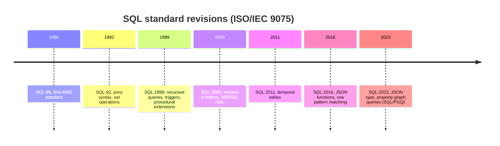
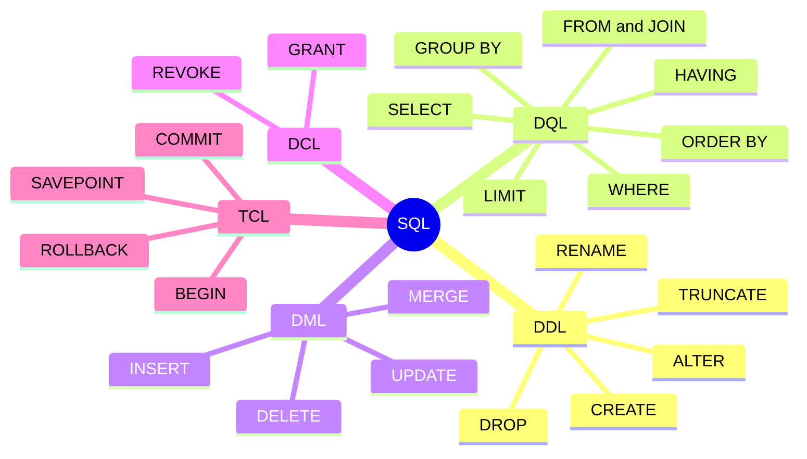

# SQL language overview

## Summary

SQL (Structured Query Language) is the declarative language of relational databases, standardized as ISO/IEC 9075 and used for more than four decades. A statement describes *what* result is wanted, and the database decides *how* to compute it. SQL is divided into statement classes: DDL defines structures, DQL queries data, DML changes data, DCL controls permissions and TCL controls transactions. On top of those come operators, functions and data types. Every major engine implements the standard with its own dialect, so portable SQL means knowing which parts are standard.

## Prerequisites

- [Relational model](../../database-design-and-models/relational/relational-model.md) for tables, keys and views.

## Core concepts

### What SQL is

SQL databases have been a primary data storage mechanism for more than four decades. Usage exploded in the late 1990s with the rise of web applications and open source options such as MySQL, PostgreSQL and SQLite.

SQL was created at IBM in the 1970s (as SEQUEL, for the System R prototype, by Donald Chamberlin and Raymond Boyce) to query data organized by Codd's relational model. The timeline lists the published standards.



*Declarative* is the key property: `SELECT ... WHERE country = 'PL'` does not say whether to use an index or scan the table. That choice belongs to the query optimizer, so the same statement can get faster when data or indexes change, without rewriting the application. See [SQL tuning](../../query-processing-and-optimization/sql-tuning.md).

*Analogy.* Writing SQL is like ordering in a restaurant: you say what dish you want, not how to cook it, and the kitchen (the optimizer) chooses the pans and the order of work. A good kitchen adapts to what is in the fridge (statistics and indexes). The analogy breaks when the kitchen makes a bad choice: unlike a diner, a database engineer can look at the recipe the kitchen chose (`EXPLAIN`) and change the conditions so that a better plan wins.

### Statement classes

The mind map shows the classes and their main statements.



| Class | Purpose | Targets and statements |
| --- | --- | --- |
| DDL, Data Definition Language | Define and change structures. | Targets: database, table, constraints, view, index. Operations: create (`CREATE`), delete (`DROP`), update (`ALTER`), rename (`ALTER ... RENAME`). |
| DQL, Data Query Language | Read data. | `SELECT`, `FROM` with joins (`JOIN`, `INNER JOIN`, `LEFT JOIN`, `RIGHT JOIN`, `FULL OUTER JOIN`, `CROSS JOIN`), `WHERE` (filter with operators and functions), `GROUP BY`, `HAVING` (filter inside grouping), `ORDER BY` (`ASC`, `DESC`), `LIMIT`. |
| DML, Data Manipulation Language | Change data. | `INSERT`, `UPDATE`, `DELETE` (and `MERGE`). |
| DCL, Data Control Language | Grant and remove permissions. | `GRANT`, `REVOKE`. |
| TCL, Transaction Control Language | Group statements into transactions. | `START TRANSACTION` or `BEGIN`, `COMMIT`, `ROLLBACK`, `SAVEPOINT`. |

The standard itself does not use the class names DQL and TCL; many texts put `SELECT` into DML. The five-class split is a teaching convention, useful for permissions (who may run DDL) and for review (DDL changes need migrations).

The join types are explained in [SQL joins](sql-joins.md), and transactions in [transactions and ACID](../../transactions-and-concurrency/transactions-and-acid.md).

### Logical processing order of SELECT

The clauses of a `SELECT` are written in one order and evaluated logically in another. Knowing the evaluation order explains why a column alias defined in `SELECT` cannot be used in `WHERE`, and why `HAVING` exists.


- `WHERE` filters rows before grouping; `HAVING` filters groups after aggregation.
- `ORDER BY` runs after `SELECT`, so it may use aliases.
- This is the logical order. The optimizer may execute in a different physical order (for example push a filter into a join) as long as the result is the same.

### Operators, functions and data types

| Group | Members |
| --- | --- |
| Logical operators | `AND`, `OR`, `NOT` |
| Comparison and pattern operators | `=`, `<>`, `<`, `>`, `BETWEEN`, `IN`, `LIKE`, `IS NULL` |
| Other operators on structures | update (`ALTER TABLE ... ALTER COLUMN`), rename (`ALTER TABLE ... RENAME`) |
| Numeric functions | `round`, `abs`, `ceil`, `floor`, `mod` |
| String functions | `upper`, `lower`, `substring`, `trim`, `concat` / `\|\|` |
| Date and time functions | `current_date`, `extract`, `date_trunc` (dialect), interval arithmetic |
| NULL functions | `coalesce`, `nullif`, `IS [NOT] DISTINCT FROM` |
| Aggregate functions | `count`, `sum`, `avg`, `min`, `max` |
| Data types | numeric (`integer`, `numeric`, `double precision`), string (`char`, `varchar`, `text`), date and time (`date`, `timestamp`, `interval`), Boolean, JSON |

### Procedural extensions

The standard defines SQL/PSM for procedural code inside the database, and each engine has its own language: PL/pgSQL (PostgreSQL), T-SQL (SQL Server), PL/SQL (Oracle), MySQL stored programs. They are used for [stored procedures](stored-procedures.md) and [triggers](triggers.md).

### Original figures

The learning map below shows the same classification of SQL with statements, operators, functions and data types. Credit: ByteByteGo, "How to Learn SQL?". (Two labels in the original contain typos: "RIFHT JOIN" means `RIGHT JOIN` and "Nemeric" means numeric.)

![Mind map by ByteByteGo titled How to Learn SQL, with SQL in the center and branches for DDL (targets database, table, constraints, view, index and operations create, drop, update, rename), DQL (SELECT, FROM with join types, WHERE, GROUP BY, HAVING, ORDER BY with ASC and DESC, LIMIT), DML (INSERT, UPDATE, DELETE), DCL (GRANT, REVOKE), TCL (start transaction, COMMIT, ROLLBACK), operators (logical AND, OR, NOT, update, rename), functions (numeric, string, datetime, null) and data types (numeric, string, datetime, Boolean, JSON)](../../_assets/query-languages/sql-language-overview-learning-map.png)

The relational design infographic in [relational model](../../database-design-and-models/relational/relational-model.md#original-figure) summarizes CRUD, keys and relationship types.

## Worked example

Tested on PostgreSQL 17.11. One statement of each class, and a query that uses every clause of the logical processing order.

```sql
-- DDL
CREATE TABLE sales (
  sale_id int GENERATED ALWAYS AS IDENTITY PRIMARY KEY,
  region  text NOT NULL,
  product text NOT NULL,
  amount  numeric(10, 2) NOT NULL CHECK (amount > 0),
  sold_at timestamptz NOT NULL DEFAULT now(),
  details jsonb
);
CREATE INDEX sales_region_idx ON sales (region);

-- DML inside TCL
BEGIN;
INSERT INTO sales (region, product, amount, sold_at) VALUES
  ('EU', 'Keyboard', 49.90, '2026-11-01'), ('EU', 'Lamp', 25.00, '2026-11-02'),
  ('EU', 'Keyboard', 49.90, '2026-11-03'), ('US', 'Keyboard', 52.00, '2026-11-03'),
  ('US', 'Lamp', 27.00, '2026-11-04'), ('APAC', 'Lamp', 24.00, '2026-11-05');
UPDATE sales SET amount = 26.00 WHERE region = 'US' AND product = 'Lamp';
COMMIT;

-- DQL
SELECT region, count(*) AS sales, sum(amount) AS revenue, round(avg(amount), 2) AS avg_ticket
FROM sales
WHERE sold_at >= DATE '2026-11-01' AND NOT (product = 'Mouse')
GROUP BY region
HAVING count(*) >= 2
ORDER BY revenue DESC
LIMIT 10;

-- DCL
CREATE ROLE reporting NOLOGIN;
GRANT SELECT ON sales TO reporting;
REVOKE SELECT ON sales FROM reporting;

-- Functions: string, numeric, date and time, NULL handling
SELECT upper('keyboard') AS string_fn, round(49.987, 2) AS numeric_fn,
       date_trunc('month', TIMESTAMP '2026-11-09 10:30') AS datetime_fn,
       coalesce(NULL, 'fallback') AS null_fn;
```

Output of the two queries:

```text
 region | sales | revenue | avg_ticket
--------+-------+---------+------------
 EU     |     3 |  124.80 |      41.60
 US     |     2 |   78.00 |      39.00
(2 rows)

 string_fn | numeric_fn |     datetime_fn     | null_fn
-----------+------------+---------------------+----------
 KEYBOARD  |      49.99 | 2026-11-01 00:00:00 | fallback
(1 row)
```

APAC is missing from the first result because `HAVING count(*) >= 2` removed its one-row group after aggregation. `GENERATED ALWAYS AS IDENTITY` is standard SQL; `LIMIT` and `date_trunc` are PostgreSQL dialect (the standard uses `FETCH FIRST 10 ROWS ONLY`).

## Trade offs and when to use it

- **Strengths.** Declarative, set-based, standardized, optimized by the engine, understood by tools and analysts.
- **Weaknesses.** Dialects differ in details (limits, upserts, date functions, identifier quoting); complex logic is awkward in pure SQL; the abstraction hides cost until you read execution plans.
- **ORM or raw SQL.** An ORM speeds up simple CRUD; complex reporting queries are clearer and faster in SQL.

## Common mistakes

- **Using `SELECT *` in application code.** Fetches unneeded columns and breaks when columns change. Fix: list columns.
- **Filtering aggregates in `WHERE`.** Fails, because `WHERE` runs before grouping. Fix: `HAVING`.
- **Building SQL with string concatenation.** Opens SQL injection. Fix: parameterized queries.
- **Assuming dialect features are standard.** Fix: check the engine documentation and prefer standard syntax in shared code.

## Practice

1. Name the five statement classes and give one statement of each.
2. Why can an alias defined in `SELECT` be used in `ORDER BY` but not in `WHERE`?
3. What is the difference between `WHERE` and `HAVING`?
4. Rewrite `LIMIT 10` in standard SQL.

Hints:

1. DDL `CREATE`, DQL `SELECT`, DML `INSERT`, DCL `GRANT`, TCL `COMMIT`.
2. `WHERE` is evaluated before `SELECT`, `ORDER BY` after it.
3. `WHERE` filters rows before grouping; `HAVING` filters groups after aggregation.
4. `FETCH FIRST 10 ROWS ONLY`.

## Further reading

- ISO/IEC 9075-2:2023, "Information technology - Database languages SQL - Part 2: Foundation". https://www.iso.org/standard/76584.html - The standard.
- Donald D. Chamberlin, Raymond F. Boyce, "SEQUEL: A Structured English Query Language", SIGFIDET 1974. https://doi.org/10.1145/800296.811515 - The origin of SQL.
- PostgreSQL Global Development Group, "The SQL Language", PostgreSQL 17 documentation, part II. https://www.postgresql.org/docs/17/sql.html - A complete and precise reference that marks standard and extension features.
- ByteByteGo, "How to Learn SQL?" (infographic). https://bytebytego.com/ - The learning map used above.
- Markus Winand, "Modern SQL". https://modern-sql.com/ - Which standard features each engine supports.
