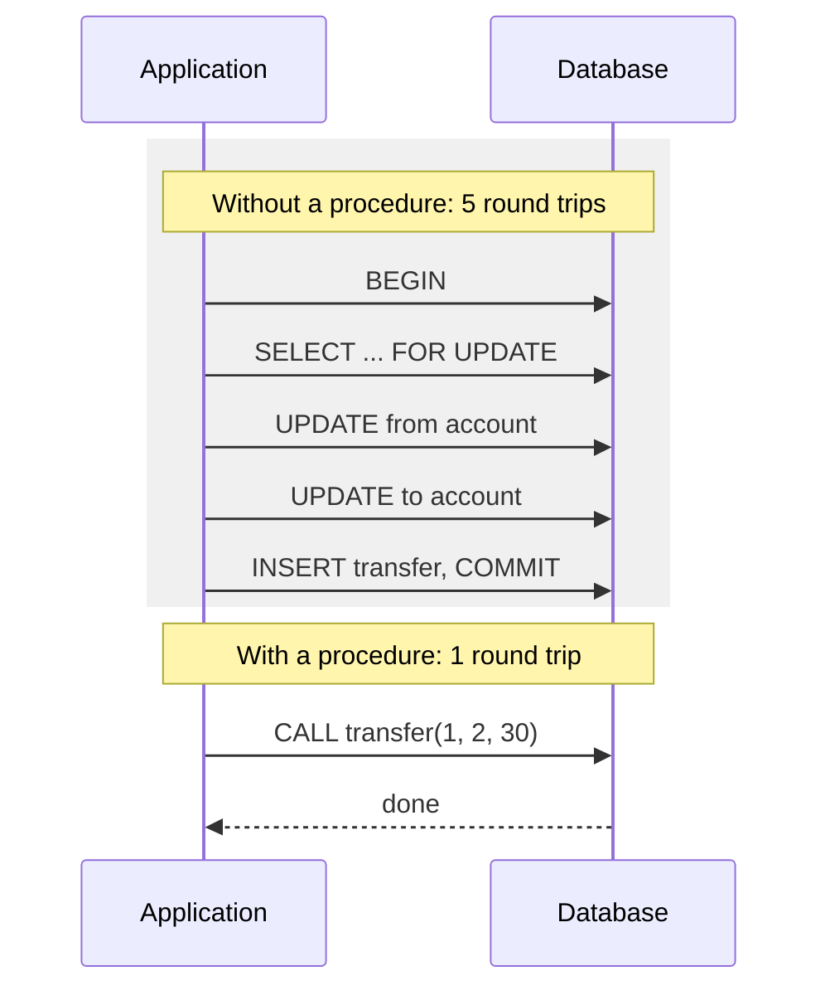

# Stored procedures

## Summary

A stored procedure is a named, precompiled collection of SQL statements and procedural logic that is stored in the database and executed on the database server. Applications call it by name with parameters instead of sending each statement. Procedures perform tasks such as retrieving or changing data or running multi-step calculations, and they can call each other. They reduce network round trips, let developers reuse logic, and give administrators a security boundary: users may run a procedure without having direct rights on the tables it touches. The costs are logic split between application and database, vendor-specific languages and harder testing and deployment.

## Prerequisites

- [SQL language overview](sql-language-overview.md), including procedural extensions.
- [Transactions and ACID](../../transactions-and-concurrency/transactions-and-acid.md) for why a procedure often wraps a transaction.

## Core concepts

### Definition

A *stored procedure* is a pre-compiled collection of SQL statements that can be executed on a database server. Stored procedures are typically used for specific tasks: retrieving data, inserting or updating data, or performing complex calculations. They are stored on the database server and can be called from a client application or from other stored procedures.

Stored procedures can improve performance by reducing the amount of SQL sent and executed per operation and let developers reuse common code. They can also provide security: database administrators control which users may execute which procedures.

"Pre-compiled" needs precision. Engines parse and validate a procedure when it is created, and cache execution plans for its statements, but plans are still chosen per execution or per session: SQL Server compiles the plan at first execution and caches it, PostgreSQL PL/pgSQL prepares each statement on first use in a session and may switch from custom to generic plans. Checked against PostgreSQL 17 and SQL Server 2022 documentation, 2026-11.

### Procedure versus function

| Aspect | Stored procedure | Stored (user-defined) function |
| --- | --- | --- |
| Called with | `CALL proc(...)` or `EXEC proc ...` | Inside an expression: `SELECT f(x)` |
| Returns | Nothing, output parameters or result sets | A value or a table |
| Transaction control | May `COMMIT` and `ROLLBACK` inside (PostgreSQL 11 and later, SQL Server, Oracle) | Runs inside the caller's transaction |
| Typical use | A business operation: "transfer money" | A computation reused in queries |

### Why use them

The sequence diagram compares a business operation done by the application statement by statement with the same operation as one procedure call.



- **Fewer round trips.** With 1 ms of network latency, five round trips cost at least 5 ms per operation and hold row locks for that time; one `CALL` costs 1 ms. Shorter lock hold times also mean less contention.
- **Encapsulation and reuse.** Several applications (a web backend, a batch job, an admin tool) call the same logic.
- **Security.** Clients get `EXECUTE` on the procedure and no rights on the tables. A *definer-rights* procedure (`SECURITY DEFINER` in PostgreSQL, `EXECUTE AS OWNER` in SQL Server, definer rights in Oracle) runs with the owner's privileges, so it is the only door to the data. It also limits the impact of SQL injection in the application, because the database account cannot run arbitrary statements on the tables.

*Analogy.* A stored procedure is a bank teller's counter. Customers do not walk into the vault; they hand over a form ("transfer 30 from account 1 to 2") and the teller, who has the keys, performs exactly that operation by the bank's rules. The analogy breaks in one place: a teller can use judgment, while a procedure does exactly what its code says, including its bugs.

### Costs

- **Split logic.** Business rules live partly in the application and partly in the database, which makes the whole harder to understand.
- **Vendor lock-in.** PL/pgSQL, T-SQL and PL/SQL are not portable.
- **Tooling.** Versioning, code review, unit testing, debugging and deployment of database code need discipline (migrations, test frameworks such as pgTAP or tSQLt).
- **Scaling.** CPU work done in procedures runs on the database server, which is the hardest component to scale.

## Worked example

Tested on PostgreSQL 17.11. A transfer procedure that validates input, locks both accounts in a fixed order, and records the transfer. The `app_user` role may call the procedure but cannot read or write the tables directly.

```sql
CREATE TABLE accounts (account_id int PRIMARY KEY, balance numeric(12, 2) NOT NULL CHECK (balance >= 0));
CREATE TABLE transfers (transfer_id int GENERATED ALWAYS AS IDENTITY PRIMARY KEY,
                        from_id int, to_id int, amount numeric(12, 2), at timestamptz DEFAULT now());
INSERT INTO accounts VALUES (1, 100), (2, 50);

CREATE PROCEDURE transfer(p_from int, p_to int, p_amount numeric)
LANGUAGE plpgsql
SECURITY DEFINER SET search_path = public      -- run with the owner's rights, fixed search path
AS $$
BEGIN
  IF p_amount <= 0 THEN
    RAISE EXCEPTION 'amount must be positive, got %', p_amount;
  END IF;
  -- lock both rows in a fixed order (lower id first) to avoid deadlocks
  PERFORM 1 FROM accounts WHERE account_id IN (p_from, p_to) ORDER BY account_id FOR UPDATE;
  UPDATE accounts SET balance = balance - p_amount WHERE account_id = p_from;
  UPDATE accounts SET balance = balance + p_amount WHERE account_id = p_to;
  INSERT INTO transfers (from_id, to_id, amount) VALUES (p_from, p_to, p_amount);
END $$;

CREATE ROLE app_user NOLOGIN;
REVOKE ALL ON accounts, transfers FROM app_user;
GRANT EXECUTE ON PROCEDURE transfer(int, int, numeric) TO app_user;

SET ROLE app_user;
CALL transfer(1, 2, 30);       -- succeeds
SELECT * FROM accounts;        -- denied: no direct table access
CALL transfer(1, 2, 500);      -- overdraft, rejected by the CHECK constraint
CALL transfer(1, 2, -5);       -- rejected by the validation
RESET ROLE;
SELECT * FROM accounts ORDER BY account_id;
SELECT from_id, to_id, amount FROM transfers;
```

Output:

```text
CALL
ERROR:  permission denied for table accounts
ERROR:  new row for relation "accounts" violates check constraint "accounts_balance_check"
DETAIL:  Failing row contains (1, -430.00).
CONTEXT:  SQL statement "UPDATE accounts SET balance = balance - p_amount WHERE account_id = p_from"
PL/pgSQL function transfer(integer,integer,numeric) line 8 at SQL statement
ERROR:  amount must be positive, got -5
CONTEXT:  PL/pgSQL function transfer(integer,integer,numeric) line 4 at RAISE
 account_id | balance
------------+---------
          1 |   70.00
          2 |   80.00
(2 rows)

 from_id | to_id | amount
---------+-------+--------
       1 |     2 |  30.00
(1 row)
```

The failed overdraft call left no trace: the debit was rolled back together with the call, so there is no half-done transfer. The fixed lock order is the resource ordering technique from [deadlocks](../../transactions-and-concurrency/deadlocks.md#prevention).

## Trade offs and when to use it

- **Use** for operations that must be atomic and are chatty (many statements per operation), for a strict security boundary around sensitive tables, and for data-intensive logic that would otherwise move many rows to the application.
- **Avoid** putting general business logic, external calls or heavy computation in the database; keep the application as the main home of business rules when several teams change them often.
- **Alternatives.** A single SQL statement with CTEs often replaces a procedure; an application-side transaction with batched statements; row-level security for access control.

## Common mistakes

- **`SECURITY DEFINER` without a fixed `search_path`.** A caller can create objects that shadow the ones the procedure uses and run code with the owner's rights. Fix: `SET search_path` on the procedure and schema-qualify names.
- **Dynamic SQL built by concatenation inside the procedure.** Reintroduces SQL injection. Fix: `EXECUTE ... USING` parameters, `format('%I', ...)` for identifiers.
- **No versioning.** Procedures changed by hand in production drift from the code. Fix: deploy them through migrations.
- **Swallowing exceptions.** A `WHEN OTHERS THEN NULL` handler hides failures. Fix: handle specific errors and re-raise the rest.

## Practice

1. List three reasons to use a stored procedure and two reasons not to.
2. Why does a definer-rights procedure limit the damage of SQL injection in the application?
3. What is the difference between a stored procedure and a stored function in PostgreSQL?
4. In the worked example, why are both rows locked in account ID order?

Hints:

1. For: round trips, reuse, security. Against: split logic, lock-in, harder testing.
2. The application's database role can only call procedures, not run arbitrary statements on tables.
3. A procedure is called with `CALL`, may control transactions and returns no value; a function is used in expressions inside the caller's transaction.
4. Two concurrent transfers in opposite directions then lock in the same order and cannot deadlock.

## Further reading

- PostgreSQL Global Development Group, "CREATE PROCEDURE" and "PL/pgSQL", PostgreSQL 17 documentation. https://www.postgresql.org/docs/17/sql-createprocedure.html - Syntax, transaction control and security options.
- PostgreSQL Global Development Group, "Writing SECURITY DEFINER Functions Safely". https://www.postgresql.org/docs/17/sql-createfunction.html#SQL-CREATEFUNCTION-SECURITY - The search path risk.
- Microsoft, "Stored procedures (Database Engine)", SQL Server documentation. https://learn.microsoft.com/en-us/sql/relational-databases/stored-procedures/stored-procedures-database-engine - Benefits and plan caching in SQL Server.
