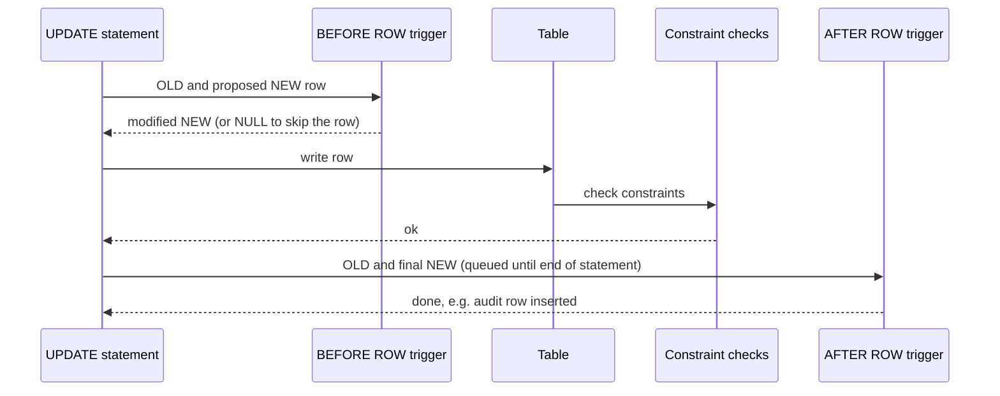

# Triggers

## Summary

A trigger is a special kind of stored procedure that the database executes automatically when a specific event occurs, instead of being called explicitly. The events are data modification on a table or view (`INSERT`, `UPDATE`, `DELETE`), data definition on database objects (`CREATE`, `ALTER`, `DROP`), and logon or logoff of a user session. Triggers are used for auditing, deriving values, enforcing complex rules and keeping denormalized copies in sync. Because they run invisibly inside every matching statement, they also make write paths slower and behavior harder to trace, so they work best when small and few.

## Prerequisites

- [Stored procedures](stored-procedures.md), since a trigger body is procedural code.
- [Integrity constraints](../../database-design-and-models/relational/integrity-constraints.md), the declarative alternative for simple rules.

## Core concepts

### Definition

*Triggers* are a special type of stored procedure that is executed automatically in response to specific events in a database. The events include:

- **data modification events** (`INSERT`, `UPDATE`, `DELETE`) on a specific table or view,
- **data definition events** (`CREATE`, `ALTER`, `DROP`) on database objects such as tables or views,
- **logon events** (connect and disconnect) that occur when a user connects to or disconnects from the database.

The SQL standard (since SQL:1999) defines only data modification triggers. DDL and logon triggers are engine extensions: Oracle has DDL and `LOGON`/`LOGOFF` triggers, SQL Server has DDL and `LOGON` triggers, and PostgreSQL has *event triggers* for DDL and, since version 17, for login. Checked against the PostgreSQL 17, SQL Server 2022 and Oracle 23ai documentation, 2026-11.

### Timing and granularity

A data modification trigger is defined by when it fires and how often.

| Dimension | Options | Meaning |
| --- | --- | --- |
| Timing | `BEFORE` | Runs before the row is written; can change `NEW` or cancel the row. Used for defaults and validation. |
| | `AFTER` | Runs after the row is written; sees the final row. Used for audit and propagation. |
| | `INSTEAD OF` | On views only: replaces the operation, which makes complex views writable. |
| Granularity | `FOR EACH ROW` | Once per affected row, with `OLD` and `NEW` row values. |
| | `FOR EACH STATEMENT` | Once per statement, even if it affects zero or a million rows. |
| Condition | `WHEN (...)` | Fires only if the condition holds, for example only if the price changed. |

The sequence diagram shows the order of execution for one row of an `UPDATE` with a `BEFORE` and an `AFTER` row trigger in PostgreSQL. All of it happens inside the statement's transaction: if any step fails, everything is rolled back.



*Analogy.* A trigger is a motion sensor light. Nobody switches it on; walking past switches it on, every time, for everyone. That is perfect for a hallway and annoying if the sensor also starts the coffee machine, the alarm and the sprinklers: people stop understanding why things happen. The analogy breaks because a slow light does not slow you down, while a slow trigger makes every write that passes it slower.

### Uses

- **Auditing.** Record who changed what and when, in an audit table.
- **Derived and denormalized data.** Maintain totals, counters, `updated_at` timestamps and copied columns (see [denormalization](../../database-design-and-models/relational/denormalization.md#derived-columns)).
- **Complex integrity rules** that `CHECK` cannot express because they read other rows or tables.
- **Writable views** with `INSTEAD OF` triggers.
- **Governance** with DDL triggers: log or block schema changes in production.
- **Session control** with logon triggers: record logins, restrict access by time or address.

### Costs and risks

- Every matching write pays the trigger's cost; a row trigger on a bulk `UPDATE` of a million rows runs a million times.
- Behavior is hidden from the application developer reading the code that issues the statement.
- Triggers can cascade (a trigger writes to a table with another trigger) and, in some engines, recurse.
- Ordering of several triggers on the same event is engine-specific (PostgreSQL fires them in alphabetical order of name).
- Logic in triggers is easy to forget during bulk loads, replication and migrations (logical replication in PostgreSQL does not fire ordinary triggers on the subscriber by default).

## Worked example

Tested on PostgreSQL 17.11. A `BEFORE` trigger sets `updated_at`, an `AFTER` trigger audits price changes only, an event trigger logs DDL, and a login event trigger logs connections.

```sql
CREATE TABLE products (product_id int PRIMARY KEY, name text NOT NULL, price numeric(10, 2) NOT NULL, updated_at timestamptz);
CREATE TABLE price_audit (product_id int, old_price numeric(10, 2), new_price numeric(10, 2),
                          changed_by text, changed_at timestamptz DEFAULT now());

-- BEFORE row trigger: modify the row being written
CREATE FUNCTION set_updated_at() RETURNS trigger LANGUAGE plpgsql AS $$
BEGIN NEW.updated_at := now(); RETURN NEW; END $$;
CREATE TRIGGER products_updated_at BEFORE UPDATE ON products
FOR EACH ROW EXECUTE FUNCTION set_updated_at();

-- AFTER row trigger with a WHEN condition: audit only real price changes
CREATE FUNCTION audit_price() RETURNS trigger LANGUAGE plpgsql AS $$
BEGIN
  INSERT INTO price_audit (product_id, old_price, new_price, changed_by)
  VALUES (OLD.product_id, OLD.price, NEW.price, current_user);
  RETURN NULL;
END $$;
CREATE TRIGGER products_price_audit AFTER UPDATE OF price ON products
FOR EACH ROW WHEN (OLD.price IS DISTINCT FROM NEW.price) EXECUTE FUNCTION audit_price();

INSERT INTO products VALUES (1, 'Keyboard', 49.90, NULL);
UPDATE products SET price = 44.90 WHERE product_id = 1;          -- audited
UPDATE products SET name = 'Keyboard TKL' WHERE product_id = 1;  -- not audited
SELECT product_id, name, price, updated_at IS NOT NULL AS has_updated_at FROM products;
SELECT product_id, old_price, new_price, changed_by FROM price_audit;

-- Event trigger on data definition events
CREATE TABLE ddl_log (command text, object text, at timestamptz DEFAULT now());
CREATE FUNCTION log_ddl() RETURNS event_trigger LANGUAGE plpgsql AS $$
DECLARE r record;
BEGIN
  FOR r IN SELECT * FROM pg_event_trigger_ddl_commands() LOOP
    INSERT INTO ddl_log (command, object) VALUES (r.command_tag, r.object_identity);
  END LOOP;
END $$;
CREATE EVENT TRIGGER track_ddl ON ddl_command_end EXECUTE FUNCTION log_ddl();
CREATE TABLE coupons (code text PRIMARY KEY);
ALTER TABLE coupons ADD COLUMN discount int;
SELECT command, object FROM ddl_log;

-- Event trigger on login (PostgreSQL 17 and later)
CREATE TABLE login_log (usr text, at timestamptz DEFAULT now());
CREATE FUNCTION log_login() RETURNS event_trigger LANGUAGE plpgsql AS $$
BEGIN INSERT INTO login_log (usr) VALUES (session_user); END $$;
CREATE EVENT TRIGGER track_login ON login EXECUTE FUNCTION log_login();
-- then, from a new connection:
SELECT usr FROM login_log;
```

Output:

```text
 product_id |     name     | price | has_updated_at
------------+--------------+-------+----------------
          1 | Keyboard TKL | 44.90 | t
(1 row)

 product_id | old_price | new_price | changed_by
------------+-----------+-----------+------------
          1 |     49.90 |     44.90 | postgres
(1 row)

   command    |       object
--------------+---------------------
 CREATE TABLE | public.coupons
 CREATE INDEX | public.coupons_pkey
 ALTER TABLE  | public.coupons
(3 rows)

   usr
----------
 postgres
(1 row)
```

Two updates ran, but only the price change produced an audit row, because of the `WHEN` condition. The DDL log shows that `CREATE TABLE` with a primary key also created an index, an implicit command an application developer may not expect.

## Trade offs and when to use it

- **Use** for cross-cutting rules that must hold for every writer: audit trails, timestamps, simple derived values, protection against schema changes.
- **Avoid** for business workflows, calls to external systems (a trigger cannot undo an email when the transaction rolls back), and heavy logic on hot tables.
- **Alternatives.** Declarative constraints and generated columns (`GENERATED ALWAYS AS (...) STORED`) for simple rules; materialized views for aggregates; change data capture (reading the write-ahead log) for propagation to other systems without slowing the write path.

## Common mistakes

- **Side effects outside the database.** Fix: write to an outbox table in the trigger and let a separate process send messages after commit.
- **Row triggers on bulk operations.** Fix: statement-level triggers with transition tables (`REFERENCING NEW TABLE AS ...`), or disable and backfill deliberately.
- **Trigger chains and recursion.** Fix: keep one level; guard with conditions such as `pg_trigger_depth()`.
- **Forgetting triggers exist.** Fix: document them next to the table definition and list them in code review (`\d table` in psql shows them).

## Practice

1. Name the three event categories that triggers respond to, and which of them the SQL standard covers.
2. When would you use a `BEFORE` row trigger instead of an `AFTER` row trigger?
3. Why is sending an email from a trigger a bad idea?
4. What does the `WHEN` clause save in the worked example?

Hints:

1. Data modification, data definition, logon; the standard covers only data modification.
2. When the trigger must change or reject the row being written.
3. The email cannot be recalled if the transaction rolls back, and the slow call holds locks.
4. It avoids running the function and writing an audit row for updates that did not change the price.

## Further reading

- PostgreSQL Global Development Group, "Triggers" and "Event Triggers", PostgreSQL 17 documentation. https://www.postgresql.org/docs/17/triggers.html - Row and statement triggers, transition tables, event triggers including `login`.
- Microsoft, "DDL triggers" and "Logon triggers", SQL Server documentation. https://learn.microsoft.com/en-us/sql/relational-databases/triggers/ddl-triggers - DDL and logon triggers in SQL Server.
- Oracle, "Using Triggers", Oracle Database PL/SQL Language Reference. https://docs.oracle.com/en/database/oracle/oracle-database/23/lnpls/plsql-triggers.html - System triggers for DDL and logon events.
