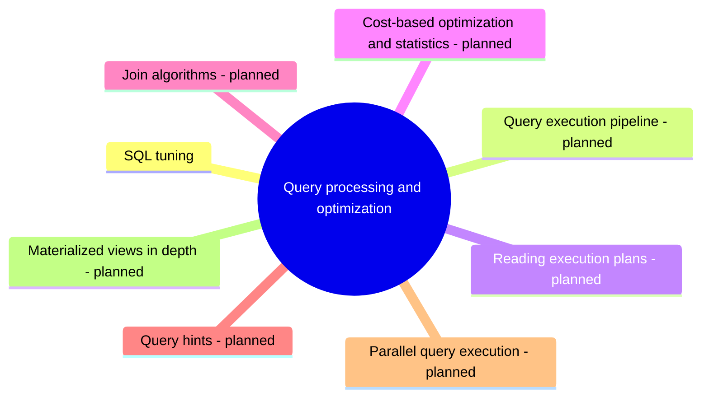

# Query processing and optimization

How a database executes a query and how to make it faster: execution plans, the optimizer, statistics, join algorithms and SQL tuning.

This area corresponds to the ACM CCS 2012 concept *DBMS engines: query processing and query optimization*. See [GUIDELINE.md](../GUIDELINE.md#311-placement-of-a-note) for what belongs here.

## Map

The map shows the parts of this section: written notes and subsections, and planned topics, which end with the word planned.

## Reading order

1. [SQL tuning](sql-tuning.md): SQL tuning (SQL optimization) is the process of making SQL queries run with less time and fewer resources.

## Planned topics

- Query execution pipeline
- Reading execution plans
- Cost-based optimization and statistics
- Join algorithms
- Query hints
- Parallel query execution
- Materialized views in depth
