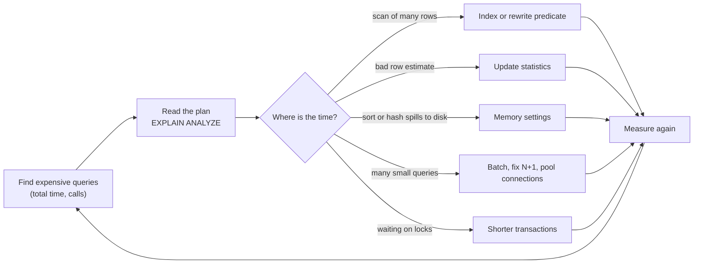
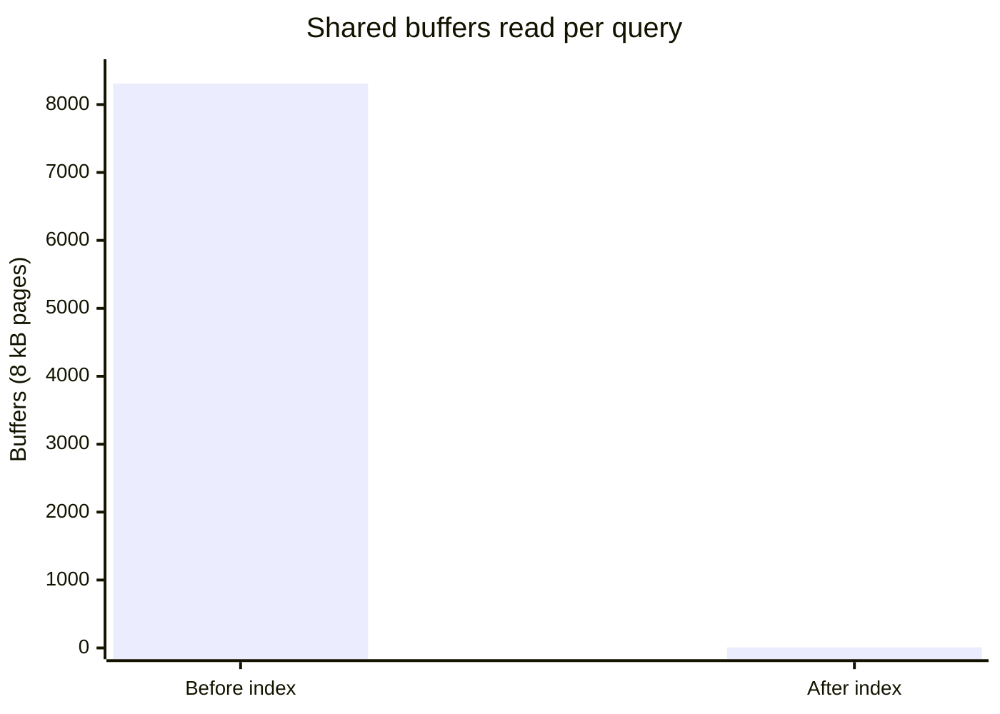

# SQL tuning

## Summary

SQL tuning (SQL optimization) is the process of making SQL queries run with less time and fewer resources. Because SQL is declarative, the database's optimizer chooses an execution plan for each query; tuning means finding where that plan spends time (by reading the plan with `EXPLAIN ANALYZE` and monitoring which queries cost the most in total) and then changing the conditions: rewriting the query, adding or changing indexes, adjusting the schema, the configuration or the way the application talks to the database. Most gains come from a small number of queries and from indexes that match them. Tuning is continuous, because data, statistics and workloads change.

## Prerequisites

- [SQL language overview](../query-languages/sql/sql-language-overview.md), in particular the logical processing order of `SELECT`.
- [SQL joins](../query-languages/sql/sql-joins.md).

## Core concepts

### Definition

*SQL tuning*, or SQL optimization, refers to the process of improving the performance of SQL queries. The goal is that queries run as efficiently as possible, reducing the time and resources required to execute them. This can involve techniques and tools to analyze and rewrite queries, optimize database structures and adjust system configuration.

The optimizer is the reason tuning is possible without changing results: it considers many equivalent plans (join orders, join algorithms, access paths) and estimates their costs from statistics about the data. Tuning either gives the optimizer better options (an index, a rewritten predicate), better information (fresh statistics), or more resources (memory, parallel workers).

The flowchart shows the tuning loop.



*Analogy.* Tuning SQL is like improving a delivery route. The driver (the optimizer) picks a route using a map (statistics). If the map is old, the driver takes a road that is now closed (bad estimate); if a new bridge is built (an index), the driver can take a shortcut. You do not drive the truck yourself; you update the map and build bridges. The analogy breaks because a bridge in a database is not free: every index slows down every insert and update on that table.

### Use cases

1. **Improving query performance.** Queries execute quickly and efficiently, particularly in high-transaction environments.
2. **Resource optimization.** Less CPU, memory and I/O per query reduces the load on database servers.
3. **Scalability.** Optimized queries and structures let the database handle increasing load.
4. **Cost reduction.** Queries that use fewer resources reduce operational costs and postpone expensive hardware upgrades.
5. **User experience.** Reports and applications retrieve and display data faster.

### Categories

| Category | Description | Techniques |
| --- | --- | --- |
| Query optimization | Improving individual queries by rewriting them, adding indexes or using hints. | Analyze execution plans; use appropriate indexes; avoid unnecessary columns in `SELECT`; use joins instead of subqueries where appropriate; write *sargable* predicates (comparing the bare column, so an index can be used). |
| Index optimization | Creating, modifying or removing indexes. | Composite indexes for multi-column searches; covering indexes; periodic rebuild or reorganization to keep indexes efficient; drop unused indexes. |
| Schema optimization | Modifying the schema for performance. | Normalization and denormalization based on use cases; partitioning large tables; materialized views for complex results; appropriate data types. |
| Configuration tuning | Adjusting database and server settings. | Memory allocation (buffer cache, sort area, such as `shared_buffers` and `work_mem` in PostgreSQL); parallel query settings; network settings for distributed databases. |
| Application-level tuning | Changing how the application interacts with the database. | Connection pooling; batch processing to reduce round trips; efficient transaction management to avoid long-running locks; avoiding N+1 query patterns from ORMs. |
| Monitoring and maintenance | Continuous monitoring and regular maintenance. | Performance monitoring tools; regularly updated statistics; identifying and resolving bottlenecks. |

### Index optimization

An *index* is a separate data structure, usually a B-tree, sorted by one or more columns and pointing to table rows. Three properties decide whether it helps:

- **Composite index column order.** An index on `(customer_id, created_at)` serves `WHERE customer_id = ?` and `WHERE customer_id = ? AND created_at >= ?`, and returns rows already sorted by `created_at` for one customer. It does not serve `WHERE created_at >= ?` alone efficiently. Rule of thumb: equality columns first, then the range or sort column.
- **Covering index.** If the index contains every column the query needs (via extra key columns or `INCLUDE`), the engine can answer from the index alone (an *index-only scan*) without visiting the table.
- **Selectivity.** An index pays off when the query returns a small fraction of the rows. For a predicate that matches 40 percent of a table, a sequential scan is usually cheaper, and the optimizer will (correctly) ignore the index.

Every index costs write time, storage and cache space, so unused indexes (PostgreSQL: `pg_stat_user_indexes.idx_scan = 0`) should be dropped.

### Key techniques

- **Execution plan analysis.** Read how the engine executes a query and identify bottlenecks: `EXPLAIN ANALYZE` (PostgreSQL, MySQL 8), `SET STATISTICS PROFILE` or actual execution plans (SQL Server), `DBMS_XPLAN` (Oracle). Compare estimated and actual row counts: a large mismatch points to stale or insufficient statistics.
- **Indexing strategies.** Create and manage indexes that match the query patterns (above).
- **SQL profilers and performance monitors.** Tools such as SQL Server Profiler and Extended Events, Oracle SQL Developer, and PostgreSQL's `pg_stat_statements` show which queries consume the most time in total. Optimize by total time (calls times mean time), not by the slowest single run.
- **Query rewriting.** Refactor queries to be more efficient: remove functions on indexed columns, replace `OR` across columns with `UNION ALL`, replace correlated subqueries, use `EXISTS` for existence checks, paginate with keyset pagination (`WHERE id > last_id`) instead of large `OFFSET`.
- **Database hints.** Guide the optimizer toward a plan (`/*+ INDEX(...) */` in Oracle and MySQL, `OPTION (...)` in SQL Server; PostgreSQL has no hints in core, only the `pg_hint_plan` extension). Hints freeze a decision that may become wrong as data changes; prefer fixing statistics or the query.
- **Partitioning.** Divide large tables into smaller pieces so that queries scan only relevant partitions (*partition pruning*) and maintenance works per partition.

### Common problems

| Problem | Description |
| --- | --- |
| Suboptimal execution plans | The engine sometimes chooses an inefficient plan, usually because of wrong cardinality estimates (stale statistics, correlated columns, parameter-sensitive plans). |
| Inadequate indexes | Missing, outdated or badly designed indexes degrade performance. |
| Lock contention | High levels of concurrent access cause locking and blocking (see [deadlocks](../transactions-and-concurrency/deadlocks.md)). |
| Resource constraints | Limited CPU, memory or I/O bottleneck query performance. |
| Poorly written queries | Inefficient SQL causes unnecessary resource use and slow performance. |

### Tools by database

| Database | Tools |
| --- | --- |
| Microsoft SQL Server | SQL Server Management Studio (SSMS), Database Engine Tuning Advisor (DTA), SQL Server Profiler (deprecated in favor of Extended Events), Query Store. |
| Oracle Database | Oracle SQL Developer, Oracle Enterprise Manager, Automatic Database Diagnostic Monitor (ADDM), SQL Tuning Advisor. |
| MySQL and MariaDB | MySQL Workbench, `EXPLAIN` and `EXPLAIN ANALYZE`, `pt-query-digest` from Percona Toolkit, Performance Schema, slow query log. |
| PostgreSQL | pgAdmin, `EXPLAIN ANALYZE`, PgHero, `pg_stat_statements`, `auto_explain`. |
| IBM Db2 | Db2 Optimizer, Visual Explain, Query Patroller (older versions; replaced by workload management in later releases). |

Engine-specific tooling is described in the engine notes, for example [PostgreSQL](../engines/postgresql/postgresql-overview.md#tooling) and [MySQL](../engines/mysql/mysql-overview.md#tooling).

## Worked example

Tested on PostgreSQL 17.11 with a table of 1 000 000 synthetic orders for 50 000 customers. The query asks for one customer's recent orders, newest first.

```sql
CREATE TABLE orders (
  order_id    bigint GENERATED ALWAYS AS IDENTITY PRIMARY KEY,
  customer_id int NOT NULL,
  status      text NOT NULL,
  created_at  timestamptz NOT NULL,
  total       numeric(10, 2) NOT NULL
);
INSERT INTO orders (customer_id, status, created_at, total)
SELECT (random() * 49999)::int + 1,
       (ARRAY['new', 'paid', 'shipped', 'cancelled'])[1 + (random() * 3)::int],
       TIMESTAMPTZ '2026-01-01' + random() * INTERVAL '300 days',
       round((random() * 500)::numeric, 2)
FROM generate_series(1, 1000000);
ANALYZE orders;

EXPLAIN (ANALYZE, BUFFERS, COSTS OFF)
SELECT order_id, created_at, total FROM orders
WHERE customer_id = 4242 AND created_at >= '2026-06-01' ORDER BY created_at DESC;
```

Plan before the index (shortened):

```text
 Gather Merge (actual time=35.502..40.699 rows=6 loops=1)
   Workers Planned: 2
   Buffers: shared hit=8308
   ->  Sort (actual time=32.151..32.152 rows=2 loops=3)
         ->  Parallel Seq Scan on orders (actual time=15.399..31.831 rows=2 loops=3)
               Filter: ((created_at >= '2026-06-01 00:00:00+00'::timestamp with time zone) AND (customer_id = 4242))
               Rows Removed by Filter: 333331
 Execution Time: 40.733 ms
```

Three processes read the whole table (8 308 buffers of 8 kB, about 65 MB) to return six rows. A composite index with the equality column first and the range and sort column second, covering `total`:

```sql
CREATE INDEX orders_customer_created_idx ON orders (customer_id, created_at DESC) INCLUDE (total);
VACUUM ANALYZE orders;
```

Plan after the index (shortened):

```text
 Sort (actual time=0.060..0.061 rows=6 loops=1)
   Buffers: shared hit=6 read=3
   ->  Bitmap Heap Scan on orders (actual time=0.043..0.050 rows=6 loops=1)
         Heap Blocks: exact=6
         ->  Bitmap Index Scan on orders_customer_created_idx (actual time=0.031..0.031 rows=6 loops=1)
               Index Cond: ((customer_id = 4242) AND (created_at >= '2026-06-01 00:00:00+00'::timestamp with time zone))
 Execution Time: 0.121 ms
```

The query now reads 9 buffers instead of 8 308 and runs in 0.121 ms instead of 40.7 ms, about 340 times faster. It still visits the table (6 heap blocks) because `order_id` is not in the index; adding it to `INCLUDE` would allow an index-only scan.



A non-sargable predicate defeats the index even after it exists:

```sql
EXPLAIN (COSTS OFF) SELECT order_id FROM orders WHERE customer_id + 0 = 4242;
```

```text
 Gather
   Workers Planned: 2
   ->  Parallel Seq Scan on orders
         Filter: ((customer_id + 0) = 4242)
```

The expression `customer_id + 0` is not the indexed column, so the planner falls back to a full scan. The same happens with `lower(email) = ...` on an index of `email`, or `date(created_at) = ...` on an index of `created_at`; the fix is to compare the bare column or to index the expression.

## Trade offs and when to use it

- Tune the queries with the highest total time first; a 10 ms query called a million times matters more than a 10 s report run once a day.
- Indexes trade write speed and storage for read speed; on write-heavy tables, keep them few and targeted.
- Configuration changes affect all queries; change one setting at a time and measure.
- When tuning is exhausted, move to the [database scaling strategies](../distributed-databases/database-scaling-strategies.md).

## Common mistakes

- **Tuning by intuition.** Fix: always read the actual plan and measure before and after.
- **Indexing every column separately.** Single-column indexes rarely serve multi-column predicates and sorts well. Fix: composite indexes designed per query.
- **Ignoring estimate errors.** A plan chosen for 10 estimated rows that actually processes 1 million is the most common cause of sudden slowness. Fix: `ANALYZE`, extended statistics for correlated columns, larger statistics targets.
- **Benchmarking on tiny data.** Plans on 1 000 rows differ from plans on 100 million. Fix: test with production-sized data.
- **Hints as a first resort.** Fix: correct statistics and queries; use hints only as a documented last resort.

## Practice

1. Name the six categories of SQL tuning and one technique of each.
2. Why does an index on `(customer_id, created_at)` serve `ORDER BY created_at` for one customer without a sort?
3. What does a large difference between estimated and actual rows in a plan tell you?
4. Why is `WHERE date(created_at) = '2026-11-09'` slow, and how do you rewrite it?

Hints:

1. Query (rewrite), index (composite), schema (partitioning), configuration (memory), application (pooling), monitoring (statistics).
2. Within one `customer_id` value the index entries are already ordered by `created_at`.
3. The statistics are stale or insufficient, so the optimizer may have chosen a bad plan.
4. The function hides the column from the index; use `created_at >= '2026-11-09' AND created_at < '2026-11-10'`.

## Further reading

- PostgreSQL Global Development Group, "Using EXPLAIN" and "Performance Tips", PostgreSQL 17 documentation, chapter 14. https://www.postgresql.org/docs/17/using-explain.html - How to read plans.
- Markus Winand, *SQL Performance Explained*, 2012, and "Use The Index, Luke". https://use-the-index-luke.com/ - Index design for developers, vendor neutral.
- Oracle, "Optimizing SQL Statements", MySQL 8.4 Reference Manual, chapter 10. https://dev.mysql.com/doc/refman/8.4/en/optimization.html - MySQL optimizer and `EXPLAIN`.
- Microsoft, "Monitor performance by using the Query Store", SQL Server documentation. https://learn.microsoft.com/en-us/sql/relational-databases/performance/monitoring-performance-by-using-the-query-store - Plan history and regressions in SQL Server.
