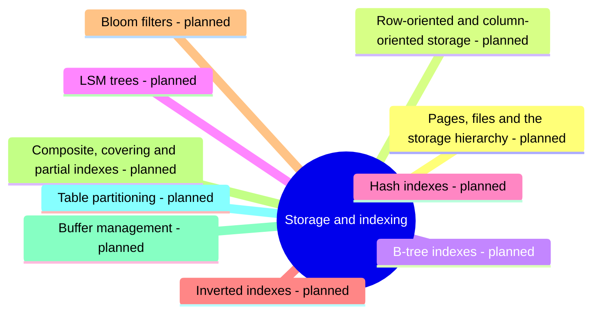

# Storage and indexing

How databases lay out data on disk and in memory and how indexes find it: pages, row and column storage, B-trees, LSM trees, hash and inverted indexes, buffer management and table partitioning.

This area corresponds to the ACM CCS 2012 concept *Data structures (data access methods, data layout)*. See [GUIDELINE.md](../GUIDELINE.md#311-placement-of-a-note) for what belongs here.

## Map

The map shows the parts of this section: written notes and subsections, and planned topics, which end with the word planned.

## Status

No notes have been written in this section yet. The planned topics below define its scope.

TODO: write the first notes of this section.

## Planned topics

- Pages, files and the storage hierarchy
- Row-oriented and column-oriented storage
- B-tree indexes
- LSM trees
- Hash indexes
- Inverted indexes
- Bloom filters
- Composite, covering and partial indexes
- Buffer management
- Table partitioning
