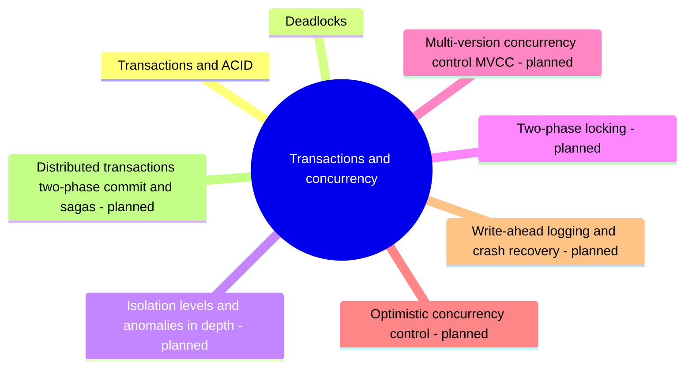

# Transactions and concurrency

How databases keep data correct when many transactions run at once and when servers crash: transactions, ACID, isolation, locking and deadlocks.

This area corresponds to the ACM CCS 2012 concept *DBMS engines: transaction processing*. See [GUIDELINE.md](../GUIDELINE.md#311-placement-of-a-note) for what belongs here.

## Map

The map shows the parts of this section: written notes and subsections, and planned topics, which end with the word planned.

## Reading order

1. [Transactions and ACID](transactions-and-acid.md): A transaction groups several reads and writes into one all-or-nothing unit of work: either every change becomes permanent at commit, or none does.
2. [Deadlocks](deadlocks.md): A deadlock occurs when two or more transactions each hold a lock that another one needs and each waits for the other to release it.

## Planned topics

- Isolation levels and anomalies in depth
- Two-phase locking
- Multi-version concurrency control (MVCC)
- Optimistic concurrency control
- Write-ahead logging and crash recovery
- Distributed transactions: two-phase commit and sagas
