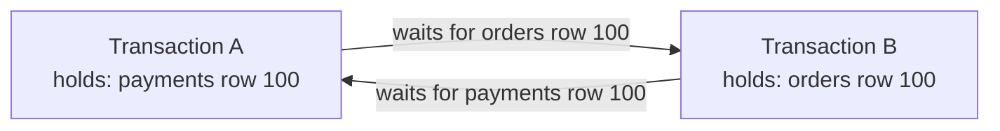
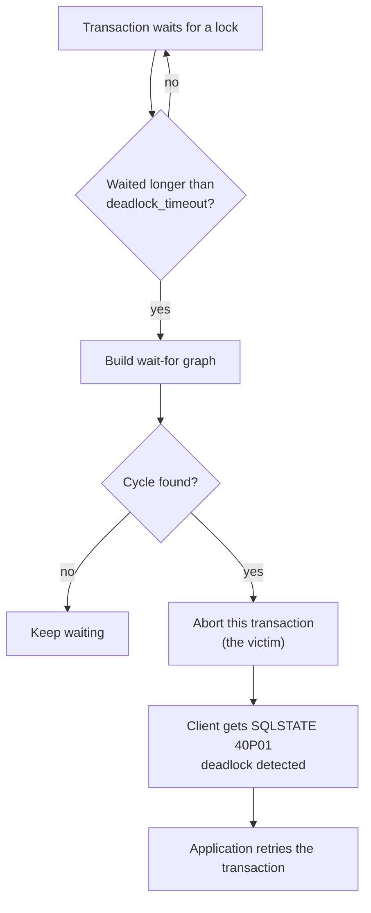

# Deadlocks

## Summary

A deadlock occurs when two or more transactions each hold a lock that another one needs and each waits for the other to release it. None of them can proceed, and without intervention they would wait forever. A deadlock is possible only when four conditions, the Coffman conditions, hold at the same time: mutual exclusion, hold and wait, no preemption and circular wait. Databases handle deadlocks mostly by detection and recovery: they find the cycle, pick one transaction as the victim and roll it back so the others can continue. Applications prevent most deadlocks by acquiring locks in a consistent order, keeping transactions short, and retrying the victim.

## Prerequisites

- [Transactions and ACID](transactions-and-acid.md), in particular isolation and locking.

## Core concepts

### Definition

A *deadlock* occurs when two or more transactions are waiting for each other to release locks on resources they need to continue processing. Neither transaction can proceed, and they would wait indefinitely.

The classic two-transaction case, with the tables of the original figure:

| Step | Transaction A | Transaction B |
| --- | --- | --- |
| 1 | `UPDATE payments SET status = 'Done' WHERE order_id = 100` (locks the payment row) | |
| 2 | | `UPDATE orders SET status = 'Paid' WHERE order_id = 100` (locks the order row) |
| 3 | `SELECT * FROM orders WHERE order_id = 100` (waits for B) | |
| 4 | | `SELECT * FROM payments WHERE order_id = 100` (waits for A) |

The wait-for graph shows the cycle: A waits for a lock that B holds, and B waits for a lock that A holds.



Whether step 3 really waits depends on the engine's concurrency control. In a lock-based engine (SQL Server with default `READ COMMITTED` and no row versioning, or any engine at `SERIALIZABLE` using locks), a `SELECT` needs a shared lock and waits behind the other transaction's exclusive lock. In an MVCC engine such as PostgreSQL, Oracle or MySQL InnoDB at its default level, a plain `SELECT` reads the last committed version and never waits for writers, so the table above does not deadlock there; two `UPDATE`s (or `SELECT ... FOR UPDATE`) in opposite order do. The [worked example](#worked-example) shows the MVCC variant.

*Analogy.* Two cars meet on a one-lane bridge from opposite ends. Each has already driven onto the bridge (holds a resource), each needs the part of the bridge the other occupies (waits), neither can be lifted off (no preemption), and each waits for the other (circular wait). Someone must reverse. The database plays the traffic officer who orders one car back. The analogy breaks in one detail: a reversed car keeps its passengers, while a rolled-back transaction loses all its work and must start again.

### Coffman conditions

The Coffman conditions, named after Edward G. Coffman Jr., who described them with Elphick and Shoshani in 1971, are four conditions that must all hold at the same time for a deadlock to occur:

| Condition | Meaning | In a database |
| --- | --- | --- |
| Mutual exclusion | At least one resource must be held in a non-shareable mode. | Exclusive row locks for writes. |
| Hold and wait | A process holds at least one resource and requests more that are held by others. | A transaction keeps its locks until commit (two-phase locking) while acquiring new ones. |
| No preemption | A resource cannot be taken from the process holding it; it is only released voluntarily. | A lock is released only at commit or rollback. |
| Circular wait | A set of processes wait for resources held by each other in a cycle. | The cycle in the wait-for graph. |

Breaking any one condition makes deadlock impossible. Databases cannot drop the first three without giving up isolation, so prevention in practice targets circular wait.

### Prevention

- **Resource ordering.** Impose a total order on all resources and require every transaction to request them in strictly increasing order. A cycle then cannot form. In practice: always lock accounts in ascending ID order, or always update `orders` before `payments`.
- **Timeouts.** A transaction that holds resources or waits for too long is rolled back (`lock_timeout` in PostgreSQL, `innodb_lock_wait_timeout` in MySQL). This bounds waiting but also kills slow non-deadlocked transactions.
- **Banker's algorithm.** A deadlock *avoidance* algorithm (Dijkstra): before granting a request, it simulates the allocation and grants it only if the system stays in a safe state where every process can still finish. It needs the maximum future demand of each process up front, which database transactions do not declare, so databases do not use it; it matters for operating systems and resource managers.
- **Timestamp schemes.** *Wait-die* and *wound-wait* use transaction start times to decide who may wait and who is aborted, so cycles never form. Some distributed databases use variants (Google Spanner uses wound-wait).
- **Short transactions and fewer locks.** Keep transactions short, touch rows in a predictable order, use indexes so that updates lock only the rows they need (a scan without an index may lock many rows in some engines), and use optimistic concurrency where conflicts are rare.

### Detection and recovery

Most DBMSs (and some operating systems) detect deadlocks instead of preventing them. Periodically, or when a lock wait exceeds a threshold (`deadlock_timeout`, 1 second by default in PostgreSQL 17), the engine builds the wait-for graph and searches it for cycles.

- **Selecting a victim.** The engine picks a transaction in the cycle to abort. Modern DBMSs implement elaborate victim selection, often configurable, based on resource use, transaction priority, the cost of rollback and similar criteria. SQL Server lets a session set `DEADLOCK_PRIORITY`; InnoDB picks the transaction that modified the fewest rows; PostgreSQL aborts the transaction that ran the detection.
- **Rollback.** The database rolls back the entire victim transaction, or in some systems just enough of it to break the deadlock. The victim's error is returned to the client, and the transaction can be restarted, either by the application or automatically by some systems.

The flowchart shows the detection path in PostgreSQL.



### Original figure

The infographic below summarizes the example, the Coffman conditions, recovery (select a victim, roll back) and prevention (resource ordering, timeouts, banker's algorithm). Credit: ByteByteGo, "What is a Deadlock?".


## Worked example

Tested on PostgreSQL 17.11 with two concurrent `psql` sessions. Both rows exist (`payments` and `orders` for order 100). Session A updates `payments` then `orders`; session B, started 0.3 seconds later, updates `orders`, reads `payments`, then updates `payments`.

```sql
-- Session A
BEGIN;
UPDATE payments SET status = 'Done' WHERE order_id = 100;
SELECT pg_sleep(1);
UPDATE orders SET status = 'Paid' WHERE order_id = 100;   -- waits for B
COMMIT;

-- Session B
BEGIN;
UPDATE orders SET status = 'Paid' WHERE order_id = 100;
SELECT pg_sleep(1);
SELECT * FROM payments WHERE order_id = 100;                -- does not wait (MVCC)
UPDATE payments SET status = 'Done' WHERE order_id = 100;   -- waits for A: cycle
COMMIT;
```

Output of session A:

```text
ERROR:  deadlock detected
DETAIL:  Process 325 waits for ShareLock on transaction 859; blocked by process 332.
Process 332 waits for ShareLock on transaction 858; blocked by process 325.
HINT:  See server log for query details.
CONTEXT:  while updating tuple (0,1) in relation "orders"
ROLLBACK
```

Output of session B:

```text
 order_id | status
----------+---------
      100 | Pending
(1 row)

UPDATE 1
COMMIT
```

Session A became the victim one second (`deadlock_timeout`) after the cycle formed, and its `COMMIT` turned into `ROLLBACK`. Session B's `SELECT` did not block and saw the committed value `Pending`, not A's uncommitted `Done`. B then committed, and both rows end as B wrote them. The fix is resource ordering: if both sessions update `orders` first, the second one simply waits for the first one to commit.

## Trade offs and when to use it

- **Detection** costs nothing until a wait occurs and lets transactions lock freely, at the price of occasional aborts. It is the default in all major engines.
- **Prevention by ordering** costs design discipline and sometimes extra locking (`SELECT ... FOR UPDATE` in a fixed order up front).
- **Timeouts** are a safety net, not a strategy: too short kills slow but healthy work, too long lets users wait.
- Every transactional application must treat a deadlock error (and a serialization failure) as retryable.

## Common mistakes

- **No retry logic.** A deadlock surfaces as a user-visible error. Fix: retry the whole transaction a few times with jittered backoff on SQLSTATE `40P01` (PostgreSQL), error 1213 (MySQL) or 1205 (SQL Server).
- **Inconsistent lock order across code paths.** Fix: define and document the order (by table, then by key).
- **Long transactions with user think time.** Fix: never wait for user input or external calls inside a transaction.
- **Missing indexes on update predicates.** Some engines lock every scanned row or range (InnoDB next-key locks), widening the window for cycles. Fix: index the columns used in `WHERE` of updates and deletes.

## Practice

1. State the four Coffman conditions. Which one do databases usually break to prevent deadlocks, and how?
2. Why does the four-step example of the original figure deadlock in a lock-based engine but not in PostgreSQL?
3. Why do databases not use the banker's algorithm?
4. What should an application do when it receives a deadlock error?

Hints:

1. Mutual exclusion, hold and wait, no preemption, circular wait; circular wait, by resource ordering.
2. In MVCC a plain `SELECT` reads a snapshot and takes no lock that waits for writers.
3. It needs each transaction's maximum resource demand in advance.
4. Roll back (already done by the server) and retry the whole transaction with backoff.

## Further reading

- E. G. Coffman, M. Elphick, A. Shoshani, "System Deadlocks", *ACM Computing Surveys* 3(2), 1971. https://doi.org/10.1145/356586.356588 - The four conditions.
- PostgreSQL Global Development Group, "Explicit Locking: Deadlocks", PostgreSQL 17 documentation, section 13.3.4. https://www.postgresql.org/docs/17/explicit-locking.html#LOCKING-DEADLOCKS - Detection, `deadlock_timeout` and advice on lock ordering.
- Oracle, "Deadlocks in InnoDB", MySQL 8.4 Reference Manual. https://dev.mysql.com/doc/refman/8.4/en/innodb-deadlocks.html - Victim selection and minimizing deadlocks in InnoDB.
- ByteByteGo, "What is a Deadlock?" (infographic). https://bytebytego.com/ - The visual summary used above.
