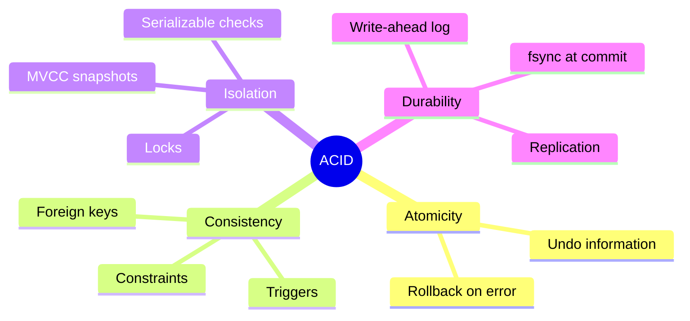
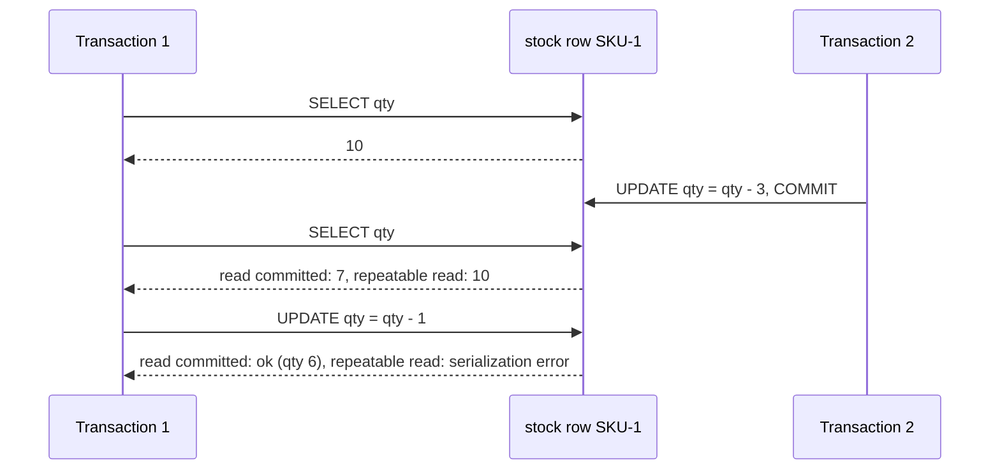

# Transactions and ACID

## Summary

A transaction groups several reads and writes into one all-or-nothing unit of work: either every change becomes permanent at commit, or none does. ACID names the four guarantees a relational database gives its transactions: Atomicity (all or nothing), Consistency (each transaction moves the database from one valid state to another), Isolation (concurrent transactions behave as if they ran one after another) and Durability (committed changes survive crashes). In practice, isolation is offered in levels, and the default level of most engines is weaker than "as if serial", which is the source of many concurrency bugs. NoSQL stores traditionally guaranteed atomicity only per key or document, though several now offer multi-item transactions.

## Prerequisites

- [Relational model](../database-design-and-models/relational/relational-model.md).
- [Integrity constraints](../database-design-and-models/relational/integrity-constraints.md), which define the "valid state" of consistency.

## Core concepts

### Transactions

A relational database is a collection of data items organized in tables. A *transaction* is a sequence of operations on those items that the database treats as one logical unit. In SQL databases, two or more updates can be executed in a transaction, an all-or-nothing wrapper that guarantees success or failure of the whole: placing two updates in one transaction ensures that either both succeed or both fail.

```sql
BEGIN;                                   -- or START TRANSACTION
UPDATE accounts SET balance = balance - 30 WHERE account_id = 1;
UPDATE accounts SET balance = balance + 30 WHERE account_id = 2;
COMMIT;                                  -- or ROLLBACK to undo both
```

Without a transaction, a crash between the two updates would destroy 30 units of money.

In a NoSQL document database, modification of a single document is atomic: if you update three values within a document, either all three are updated or the document stays unchanged. Updates to several documents were historically not covered; multi-document transactions now exist in some engines with limits (see [SQL versus NoSQL](../foundations/sql-vs-nosql.md#transactions)).

### ACID

*ACID* is a set of properties of database transactions, named by Haerder and Reuter in 1983 on the basis of Jim Gray's work.

- **Atomicity.** Each transaction is all or nothing. If any part fails, the database undoes every change the transaction made.
- **Consistency.** Any transaction brings the database from one valid state to another. "Valid" means all declared rules hold: constraints, foreign keys, triggers. Consistency is partly the application's job: the database enforces declared rules, but a transaction that transfers money to the wrong account is consistent in this sense and still wrong.
- **Isolation.** Executing transactions concurrently has the same result as executing them serially, one after another. This is the ideal (serializability); real engines offer weaker levels too.
- **Durability.** Once a transaction has been committed, it stays committed, even after a power loss or crash.

The mind map lists the mechanism each property relies on inside the engine.



*Analogy.* A transaction is a bank transfer made at a single counter. The clerk either moves the money from one account to the other or, if anything goes wrong, puts everything back (atomicity). The bank's rules say no account may go below zero (consistency). Other customers at other counters never see the money in transit (isolation). Once you get the receipt, the transfer is recorded in a ledger that survives a fire in the branch (durability). The analogy breaks for isolation: real databases let customers see some in-transit states, depending on the isolation level, while a well-run bank never would.

### How durability and atomicity are implemented

Most engines use a *write-ahead log* (WAL, also redo log or transaction log): every change is first appended to a sequential log, and a commit returns only after the log record is flushed to stable storage. After a crash, the engine replays the log to redo committed changes and discards (or undoes) uncommitted ones. Data pages can therefore be written lazily. Durability can be weakened on purpose for speed (`synchronous_commit = off` in PostgreSQL, `innodb_flush_log_at_trx_commit = 2` in MySQL), which risks losing the last few hundred milliseconds of commits on a crash.

### Isolation levels

The SQL standard defines isolation through *anomalies* (phenomena) that each level must prevent.

| Anomaly | What happens |
| --- | --- |
| Dirty read | A transaction reads data written by another transaction that has not committed (and may roll back). |
| Non-repeatable read | A transaction reads the same row twice and gets different values, because another transaction committed a change in between. |
| Phantom read | A transaction runs the same range query twice and gets a different set of rows, because another transaction inserted or deleted matching rows. |
| Lost update | Two transactions read a value, both modify it and write it back; one write silently overwrites the other. |
| Write skew | Two transactions read overlapping data, make disjoint writes based on what they read, and together break an invariant (two doctors both go off call). |

| Level (standard) | Dirty read | Non-repeatable read | Phantom | PostgreSQL 17 behavior |
| --- | --- | --- | --- | --- |
| Read uncommitted | possible | possible | possible | Behaves as read committed. |
| Read committed | prevented | possible | possible | Default. Each statement sees a fresh snapshot. |
| Repeatable read | prevented | prevented | possible | Snapshot isolation: also prevents phantoms; aborts on concurrent update of the same row. |
| Serializable | prevented | prevented | prevented | Serializable snapshot isolation: also prevents write skew by aborting one transaction. |

Defaults differ: PostgreSQL, Oracle and SQL Server default to read committed; MySQL InnoDB defaults to repeatable read. Checked against PostgreSQL 17 and MySQL 8.4 documentation, 2026-11.

The diagram shows the non-repeatable read from the worked example: under read committed the second read sees the concurrent commit; under repeatable read it does not, and the later update fails instead.



Concurrency control is implemented with *locks* (two-phase locking: acquire during the transaction, release at commit) or with *multi-version concurrency control* (MVCC: writers create new row versions, readers read a snapshot and never block writers), or a mix. Locks can produce [deadlocks](deadlocks.md); MVCC needs cleanup of old versions (VACUUM in PostgreSQL, see [VACUUM](../engines/postgresql/vacuum.md)).

### ACID in distributed systems

When data is spread over shards or services, a transaction across them needs a distributed commit protocol (two-phase commit), which adds latency and blocks if the coordinator fails. Many systems instead keep transactions within one shard and use sagas (a sequence of local transactions with compensating actions) across shards. This is one of the hardest problems of [sharding](../distributed-databases/sharding.md#cross-shard-transactions).

## Worked example

Tested on PostgreSQL 17.11. A `stock` table with `CHECK (qty >= 0)` and one row with quantity 10.

Atomicity: the second update violates the constraint, and the first one is undone too.

```sql
BEGIN;
UPDATE stock SET qty = qty - 4 WHERE sku = 'SKU-1';   -- ok, 6
UPDATE stock SET qty = qty - 8 WHERE sku = 'SKU-1';   -- would be -2
COMMIT;
SELECT qty FROM stock;
```

```text
ERROR:  new row for relation "stock" violates check constraint "stock_qty_check"
DETAIL:  Failing row contains (SKU-1, -2).
ROLLBACK
 qty
-----
  10
(1 row)
```

Isolation: transaction 1 reads the quantity, waits one second, reads it again and decrements it. Half a second after it starts, another session runs `UPDATE stock SET qty = qty - 3` and commits.

```sql
BEGIN ISOLATION LEVEL READ COMMITTED;        -- second run: REPEATABLE READ
SELECT qty AS first_read FROM stock WHERE sku = 'SKU-1';
SELECT pg_sleep(1);
SELECT qty AS second_read FROM stock WHERE sku = 'SKU-1';
UPDATE stock SET qty = qty - 1 WHERE sku = 'SKU-1';
COMMIT;
```

| Level | first_read | second_read | UPDATE | Final qty |
| --- | --- | --- | --- | --- |
| Read committed | 10 | 7 | succeeds | 6 |
| Repeatable read | 10 | 10 | `ERROR: could not serialize access due to concurrent update`, rolled back | 7 |

Under read committed, the transaction saw two different values for the same row (a non-repeatable read). Under repeatable read, it saw a stable snapshot, and PostgreSQL refused the update that would have been based on stale data, so the application must retry.

## Trade offs and when to use it

- **Stronger isolation** removes anomalies but causes more aborts (serialization failures) or more waiting (locks), so throughput under contention drops and retries become mandatory.
- **Read committed** is a reasonable default for most OLTP, provided read-modify-write sequences use atomic updates (`SET qty = qty - 1`), `SELECT ... FOR UPDATE` or optimistic version checks.
- **Serializable** is the simplest way to be correct for complex invariants across rows, if the application retries.
- **Relaxed durability** (asynchronous commit) is acceptable for data you can recompute, never for money.

## Common mistakes

- **Read-modify-write in application code at read committed.** Two requests read 10, both write 9: a lost update. Fix: atomic `UPDATE ... SET x = x - 1`, `FOR UPDATE`, or a version column.
- **No retry on serialization failure or deadlock.** Fix: retry the whole transaction on SQLSTATE `40001` and `40P01`.
- **Long transactions.** They hold locks, block VACUUM and increase conflicts. Fix: keep transactions short; no network calls inside.
- **Assuming "Consistency" in ACID means the CAP "consistency".** They are different: ACID consistency is about integrity rules, CAP consistency is about replicas agreeing (linearizability).

## Practice

1. Define each ACID property in one sentence and name the mechanism that implements it.
2. Which anomaly does repeatable read prevent that read committed allows? Show it with two transactions.
3. Why is `UPDATE stock SET qty = qty - 1` safe at read committed while `SELECT qty` followed by `UPDATE stock SET qty = 9` is not?
4. What is write skew, and which PostgreSQL level prevents it?

Hints:

1. Atomicity: undo and rollback; consistency: constraints; isolation: locks or MVCC; durability: write-ahead log flushed at commit.
2. Non-repeatable read: T1 reads, T2 updates and commits, T1 reads again and sees a new value.
3. The first is evaluated on the latest committed row under a row lock; the second writes a value computed from a possibly stale read.
4. Disjoint writes based on overlapping reads break an invariant; serializable.

## Further reading

- Theo Haerder, Andreas Reuter, "Principles of Transaction-Oriented Database Recovery", *ACM Computing Surveys* 15(4), 1983. https://doi.org/10.1145/289.291 - The paper that coined ACID.
- Jim Gray, Andreas Reuter, *Transaction Processing: Concepts and Techniques*, Morgan Kaufmann, 1992. - The reference work on transactions, logging and locking.
- Hal Berenson et al., "A Critique of ANSI SQL Isolation Levels", SIGMOD 1995. https://doi.org/10.1145/223784.223785 - Why the standard's anomaly definitions are incomplete; defines snapshot isolation.
- PostgreSQL Global Development Group, "Transaction Isolation", PostgreSQL 17 documentation, section 13.2. https://www.postgresql.org/docs/17/transaction-iso.html - Exact behavior of each level.
- Donne Martin, "The System Design Primer: RDBMS" (GitHub). https://github.com/donnemartin/system-design-primer#relational-database-management-system-rdbms - The short ACID definitions.
